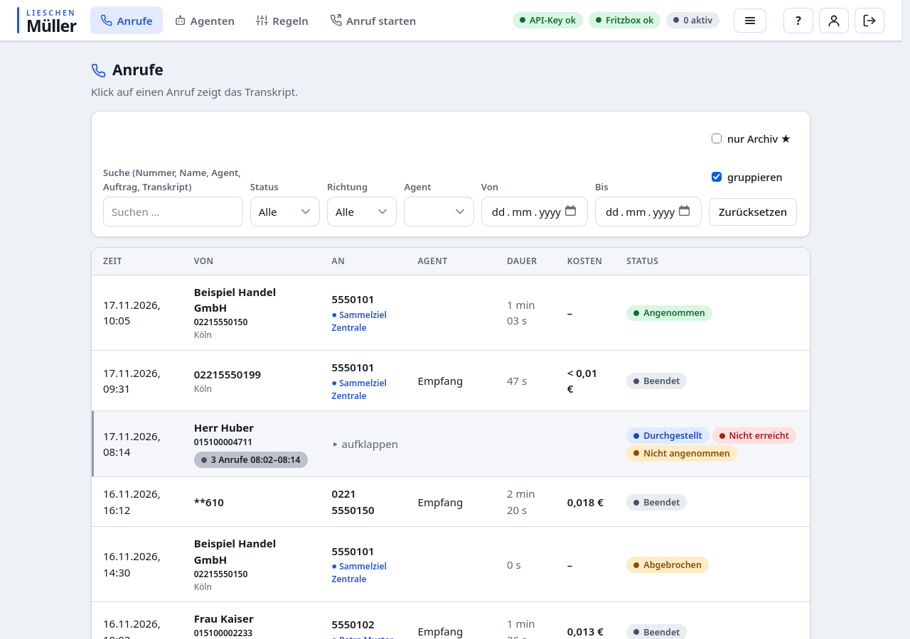
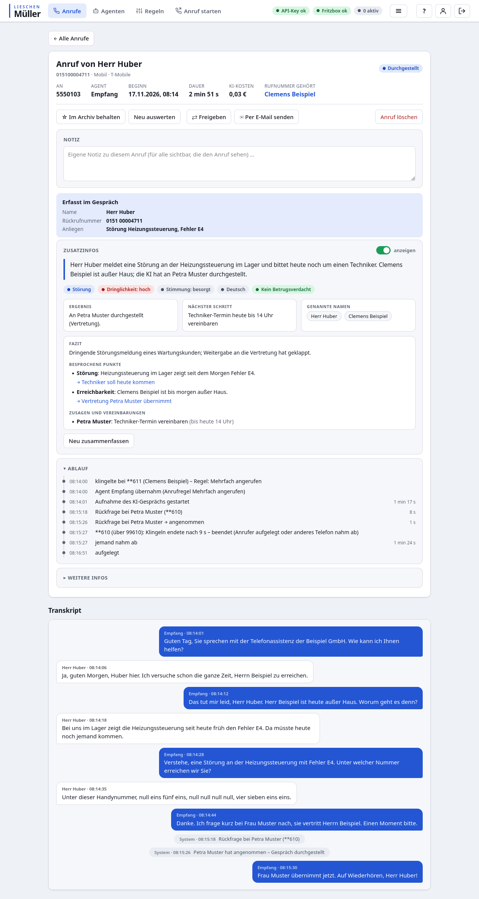
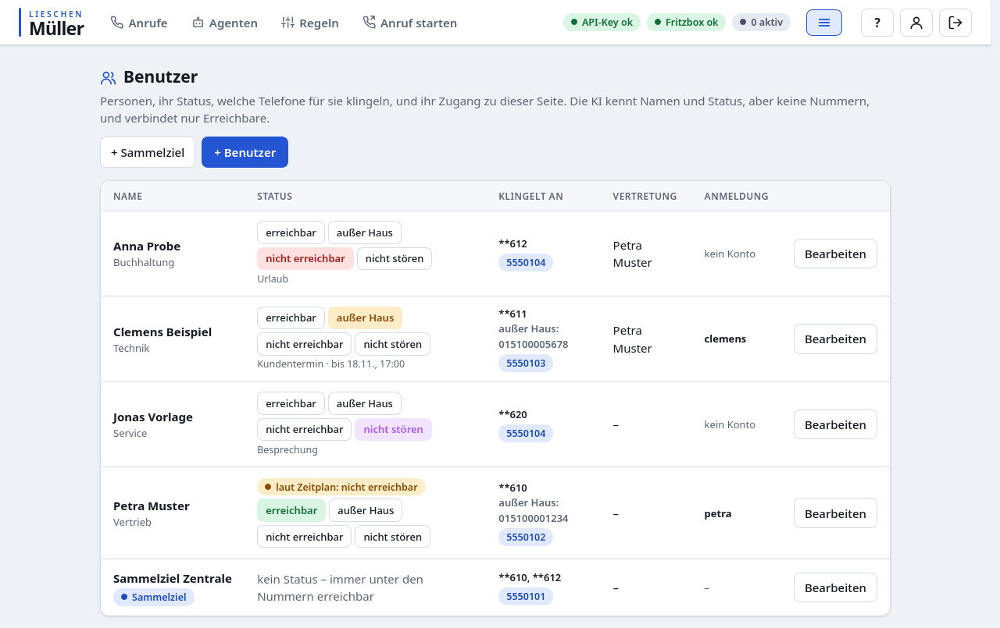
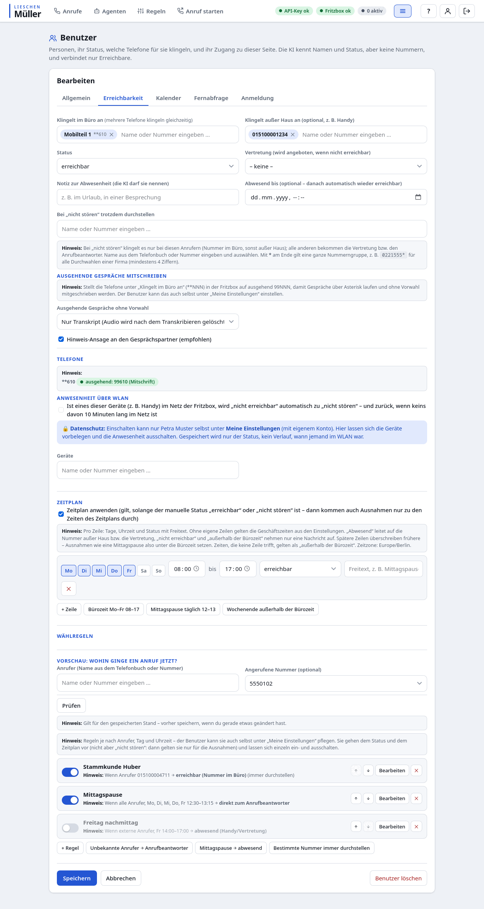
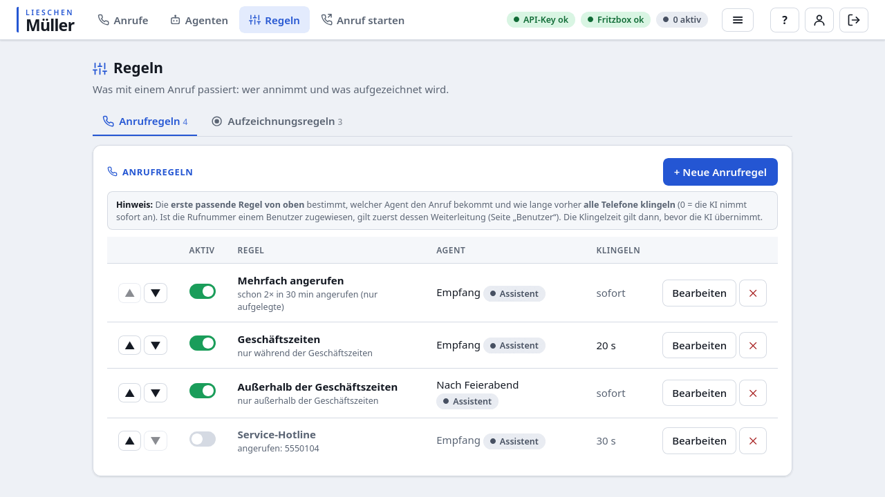
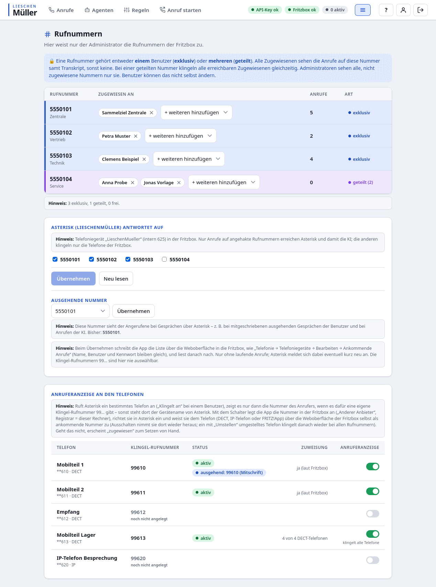
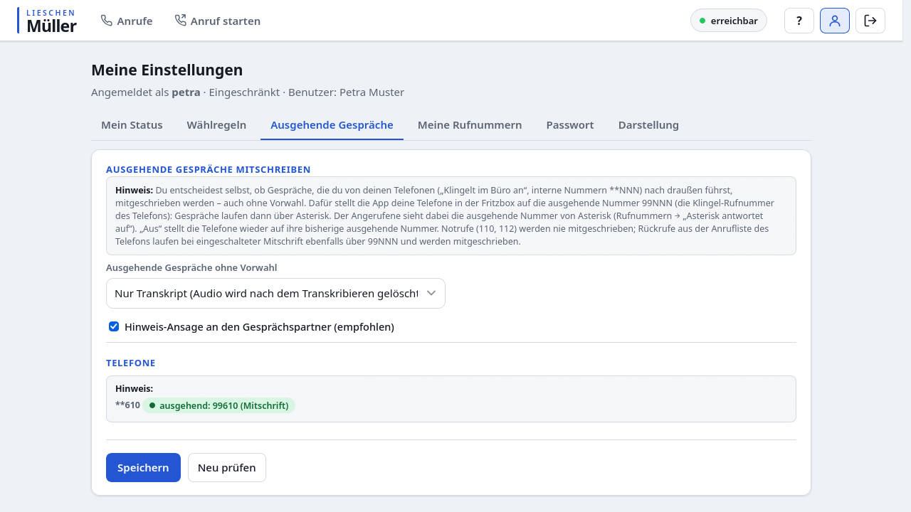
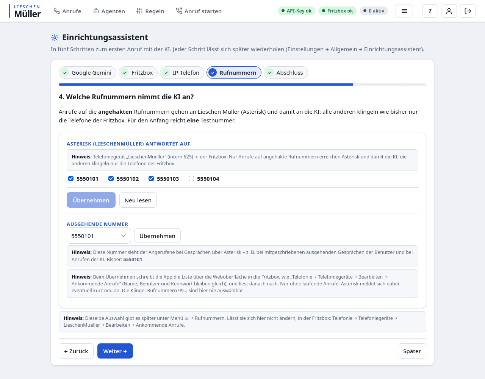
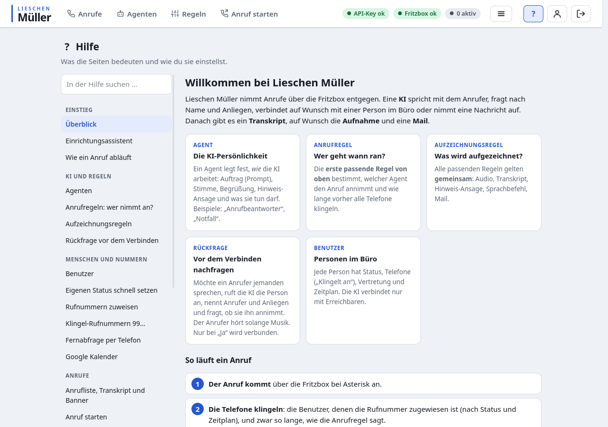
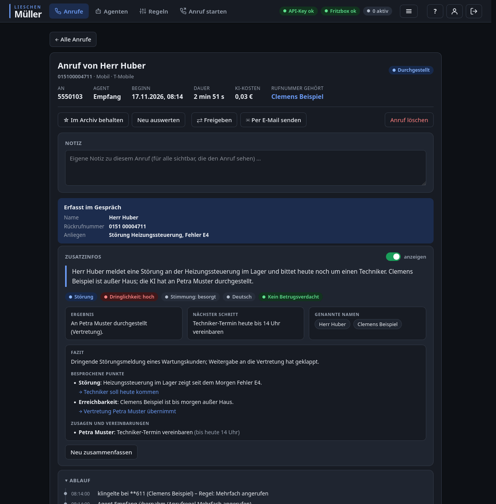

# Lieschen Müller – KI-Telefonassistent für die Fritzbox

Ein Telefonassistent, der an einer Fritzbox als IP-Telefon hängt. Er nimmt Anrufe an, spricht mit den Anrufern (Google Gemini Live),
schreibt mit, vermittelt an Benutzer, ruft selbst an und wird über eine Weboberfläche verwaltet.
**Noch nie installiert? → `./install.sh` aufrufen und dem Einrichtungsassistenten in der Weboberfläche folgen; Schritt für Schritt: [Schnellstart für Einsteiger](docs/wiki/Schnellstart-fuer-Einsteiger.md)** (ohne Vorwissen).
Gedacht für den Betrieb als Container (Docker/Podman, produktiv unter Docker Compose, TrueNAS SCALE vorbereitet).

```
Telefone / Anrufer ── Fritzbox ──SIP──> Asterisk ──AudioSocket──> Bridge (Python/FastAPI) ──> Google Gemini Live
                         ▲                 ▲  AMI (Anrufe auslösen/umleiten)    │
                         └── TR-064 ───────┼──────────────────────────────────── ├── SQLite (/data)
                              (Telefonbuch)                                     └── Weboberfläche (Port 8080)
```

## Was es kann
- **Anrufe annehmen** mit konfigurierbaren **KI-Agenten** (Persönlichkeit: Auftrag, Stimme, Modell, Hinweis-Ansage, Fragenliste, eigene Aktionen)
  und **Anrufregeln** (wer nimmt wann an: nach angerufener Nummer, Anrufer, Zeitfenster; vorher klingeln alle Telefone, auf Wunsch mit Anzeige der Anrufernummer).
- **Aufzeichnungsregeln:** was aufgezeichnet wird (Audio, Transkript, KI-Gespräche), je Anrufer/Nummer/Zeit/Agent; im laufenden Anruf per Klick zuschalten,
  per Sprachbefehl („Lieschen, keine Aufzeichnung“) beenden, Anrufe archivieren, teilen und mit Notiz versehen; Aufnahme als MP3 und per Mail.
- **Benutzer und Erreichbarkeit:** Status (im Büro / außer Haus / nicht erreichbar), Vertretung, Zeitplan, Wählregeln je Anrufer/Uhrzeit,
  Durchstellen an Handy/Festnetz, „KI übernimmt, wenn niemand abnimmt“, Anrufbeantworter-Verhalten (verzögerte Annahme, Geschäftszeiten).
- **Rückfrage vor dem Verbinden:** Die KI fragt beim Benutzer nach, ob er den Anrufer sprechen möchte (Mailbox-Erkennung, Zeitlimit, Wartemusik).
- **Live-Banner** für klingelnde und laufende Anrufe mit Routing per Klick (KI annehmen lassen, durchstellen, Agent wechseln, auflegen).
- **Gespräche mit Mitschrift:** eigene Telefonate getrennt aufnehmen und (fast live) transkribieren; Aufzeichnungshinweis für den Angerufenen.
  Ausgehend aufgezeichnet wird, wenn man vor die Nummer die Vorwahl wählt (Standard `*77`, einstellbar, z. B. `000`; dazu eine Wahlregel in der Fritzbox).
- **Ausgehende Anrufe** mit Auftrag und Vorlagen; **Kampagnen** (Plugin) mit Zielen aus dem Telefonbuch, Anrufzeiten, Wiederholungen,
  Anrufbeantworter-Erkennung und Terminpool mit Buchung.
- **Fernabfrage per Telefon:** Benutzer erkennen sich an Rufnummer **und** Codewörtern, lassen sich Anrufe auflisten, Zusammenfassungen vorlesen,
  Gespräche abspielen, zurückrufen oder mit Kontakten verbinden.
- **Google Kalender der Benutzer:** berechtigte Anrufer erfahren, wo ein Benutzer ist; Termine per Fernabfrage abfragen und eintragen.
- **Stimmung und Zusatzinfos:** Stimmungseindruck des Anrufers als Auslöser für Agentenwechsel, Zusammenfassung, Anliegen, Dringlichkeit, Betrugsverdacht.
- **Benachrichtigungen per E-Mail** (z. B. Outlook/Microsoft 365) je Rufnummer und Empfänger sowie ein **täglicher Bericht**.
- **Konten und Sichtbarkeit:** Anmeldung mit Rollen; wer eine Rufnummer zugewiesen hat, sieht die Anrufe darauf (exklusiv oder geteilt).
- **Kosten** in Euro (Tokens je Anruf, Monatsübersicht, Budget) und **Telefonbuch-Abgleich** mit der Fritzbox.
- **Plugins:** eigene Erweiterungen in Python (siehe [docs/PLUGINS.md](docs/PLUGINS.md)).

## Bilder
Alle Bilder zeigen eine Demo-Instanz mit **erfundenen Daten** (Personen, Firmen, Rufnummern aus dem 555er-/0000er-Block); erzeugt mit
`tools/demo_shots.py` (Wegwerf-Bridge ohne Netz, Fake-Fritzbox, siehe `tools/demo_seed.py`).

| | |
|---|---|
| [](docs/img/anrufliste.png)<br>**Anrufliste** – wiederholte Anrufe derselben Nummer gruppiert, Status, Kosten | [](docs/img/anruf-detail.png)<br>**Anruf** – Zusammenfassung, Ablauf (Klingeln, Rückfrage, Durchstellen) und Transkript |
| [](docs/img/benutzer.png)<br>**Benutzer** – Status, Vertretung, Telefone, Rufnummern, Sammelziel | [](docs/img/benutzer-editor.png)<br>**Benutzer bearbeiten → Erreichbarkeit** – Telefone, Zeitplan, Wählregeln, Vorschau |
| [](docs/img/regeln.png)<br>**Regeln** – wer wann annimmt (u. a. „mehrfach angerufen“) | [](docs/img/rufnummern.png)<br>**Rufnummern** – Zuweisung, „Asterisk antwortet auf“, Anruferanzeige je Telefon |
| [](docs/img/meine-einstellungen.png)<br>**Meine Einstellungen → Ausgehende Gespräche** – Mitschrift ohne Vorwahl | [](docs/img/einrichtung.png)<br>**Einrichtungsassistent** – Gemini, Fritzbox, IP-Telefon, Rufnummern |
| [](docs/img/hilfe.png)<br>**Hilfe** – in der Oberfläche, mit Suche | [](docs/img/anruf-detail-dunkel.png)<br>**Dunkle Darstellung** – folgt dem System ([Liste](docs/img/anrufliste-dunkel.png), [Benutzer](docs/img/benutzer-dunkel.png)) |

## Voraussetzungen
> **Lieschen Müller funktioniert nur mit einer AVM Fritzbox.** Andere Router und Telefonanlagen (auch andere SIP-Anlagen) werden nicht unterstützt:
> Die Software benutzt Funktionen, die es so nur bei der Fritzbox gibt, und steuert sie zum Teil über deren Weboberfläche.

### Was von der Fritzbox benutzt wird
| Funktion der Fritzbox | wofür Lieschen Müller sie braucht | wenn sie fehlt oder ausfällt |
|---|---|---|
| **IP-Telefon** („Telefoniegerät → LAN/WLAN“), SIP-Anmeldung von Asterisk an der Fritzbox (Registrar = Fritzbox) | Weg der KI ins Telefonnetz: Anrufe annehmen, ausgehende KI-Anrufe | ohne dieses Gerät geht nichts |
| **Rufnummer „Anderer Anbieter“ `99NNN`** (Klingel-Rufnummern, Registrar = **dieser Rechner**) | alle Telefone klingeln lassen und die Nummer des Anrufers im Display zeigen; Vorwahl-Weg und Umstellen der ausgehenden Nummer für Mitschriften | die Fritzbox klingelt selbst, die KI übernimmt als IP-Telefon; Anruferanzeige und Mitschrift ausgehender Gespräche entfallen |
| **TR-064** (Schnittstelle der Fritzbox) | Telefonbuch abgleichen, Rufnummern und interne Anschlüsse lesen, Anrufliste („wer hat angenommen?“), Geräteliste und WLAN-Anwesenheit, Klingel-Rufnummern anlegen, Rufnummern des IP-Telefons ändern (Rückfall) | Kontakte-Abgleich, Rufnummern-Seite und Anwesenheit funktionieren nicht; Telefonieren und KI-Gespräche laufen weiter |
| **Weboberfläche der Fritzbox** (`login_sid.lua`, `query.lua`, `data.lua`, Seiten `edit_dect_num` und `edit_ipfon_num`) – **inoffiziell** | Rufnummern von DECT- und IP-Telefonen lesen **und schreiben** (TR-064 kann das für DECT nicht), ausgehende Rufnummer eines Telefons umstellen | siehe Kasten unten |

**Inoffiziell, getestet mit FRITZ!OS 8.25.** Die Weboberfläche der Fritzbox ist keine dokumentierte Schnittstelle. Nach einem FRITZ!OS-Update kann sie anders aussehen und
die Funktionen ausfallen. Die App schreibt dann **nichts** (sie prüft das Formular vor dem Speichern, liest danach zurück und stellt bei einer Abweichung den alten Stand wieder her).
Was dann noch geht: Telefonieren, KI-Gespräche, Klingeln, Telefonbuch, Rufnummernliste und Anwesenheit (TR-064). Was dann von Hand in der Fritzbox geschehen muss:
Rufnummern der DECT-Telefone zuweisen (die Oberfläche zeigt „zugewiesen“ zum Abhaken), die ausgehende Nummer eines Telefons umstellen
(und damit auch die Mitschrift ausgehender Gespräche ohne Vorwahl); die Rufnummern des Asterisk-IP-Telefons ändert die App im Notfall über TR-064.
Ausführlich: [Wiki → Voraussetzungen und Fritzbox](docs/wiki/Voraussetzungen-und-Fritzbox.md).

### Rechte, Netzwerk, Konten
- **Fritzbox-Benutzer** (für TR-064 und die Weboberfläche, eigener Benutzer empfohlen) mit dem Recht **„FRITZ!Box Einstellungen“**; in der Fritzbox muss der
  Zugriff über TR-064 erlaubt sein (Heimnetz → Netzwerk → Netzwerkeinstellungen → Heimnetzfreigaben → „Zugriff für Anwendungen zulassen“, je nach FRITZ!OS-Version hinter „Weitere Einstellungen“).
  Dieses Recht ist weitreichend: Zugangsdaten schützen (sie liegen im Klartext in der Datenbank).
- **Gerätename/-benutzer des IP-Telefons** (Benutzername und Kennwort ohne `;`) – das ist ein anderer Zugang als der TR-064-Benutzer.
- **Netzwerk:** Der Rechner mit Asterisk steht im **selben LAN wie die Fritzbox** und läuft mit **Host-Netzwerk** (SIP/RTP ohne NAT). Frei sein müssen `5060/udp` (SIP), der RTP-Bereich von Asterisk
  und der Web-Port (Standard `8080`). Asterisk nimmt SIP nur von der Fritzbox-Adresse an (IP-Sperre, Notschalter `SIP_ACL=0`); die Adresse sollte als **IP** eingetragen sein.
- **Google Gemini:** entweder ein **API-Schlüssel aus Google AI Studio mit aktivierter Abrechnung** (die Live-Modelle kosten Geld) **oder Vertex AI** in der EU
  (Google-Cloud-Projekt mit Dienstkonto-Schlüsseldatei `data/vertex.json`, Rolle „Vertex AI User“; Verarbeitung im Standort `eu`).
- **Software:** Docker Compose oder Podman Compose (zwei Container: Asterisk, Bridge) und `python3` auf dem Host für `asterisk/render.sh`.
- Fritzbox-Zugang, Gemini-Schlüssel und Aufbewahrung trägt der Administrator nach dem Start unter *Einstellungen* ein, nicht in der `.env`.

### Funktion → braucht
| Funktion | braucht |
|---|---|
| Anrufe annehmen, mit der KI sprechen | Fritzbox mit IP-Telefon; Gemini (Schlüssel oder Vertex AI); Anrufregel |
| Alle Telefone klingeln, Anrufer im Display | Klingel-Rufnummer `99NNN` („Anderer Anbieter“, Registrar = dieser Rechner), allen Telefonen zugewiesen |
| An Benutzer durchstellen, Rückfrage | interne Nummern/Telefone in der Fritzbox; Rufnummern den Benutzern zugewiesen |
| Telefonbuch, Rufnummernliste, „wer hat angenommen?“ | TR-064-Benutzer mit Recht „FRITZ!Box Einstellungen“ |
| WLAN-Anwesenheit | TR-064 (Geräteliste), Recht „FRITZ!Box Einstellungen“ |
| Anruferanzeige je Telefon einrichten | TR-064 (Konto anlegen) und Weboberfläche der Fritzbox (Rufnummer dem Telefon zuweisen) |
| Ausgehende Gespräche aufzeichnen (Vorwahl, Standard `*77`, z. B. `000`) | Wahlregel in der Fritzbox → `99NNN`, bei Asterisk eingeschaltet |
| Mitschrift ohne Vorwahl, je Benutzer | Weboberfläche der Fritzbox (ausgehende Nummer des Telefons), `99NNN` angelegt und angemeldet |
| E-Mail-Benachrichtigungen | SMTP-Konto (Outlook, Microsoft 365 …) |
| Google Kalender | Google-Dienstkonto (JSON-Schlüssel), geteilte Kalender |
| Vertex AI (EU) | Google-Cloud-Projekt, Dienstkonto, `data/vertex.json` |

## Schnellstart
```bash
./install.sh                    # prüft Docker/Compose (oder podman-compose), legt .env mit zufälligem Admin-Passwort an, startet, zeigt URL + Passwort
```
Danach die angezeigte Adresse öffnen (`http://<host>:8080`), mit **admin** und dem angezeigten Passwort anmelden: Der **Einrichtungsassistent** führt durch Gemini-Schlüssel,
Fritzbox-Zugang, IP-Telefon (mit Anzeige der Anmeldung) und die Rufnummern für die KI. Aktualisieren: `./install.sh --update` (sichert vorher `data/` nach `backup/`).

Für Fortgeschrittene, von Hand:
```bash
cp .env.example .env            # nur UI_PASSWORD (und ggf. WEB_PORT) setzen; Fritzbox und Gemini-Schlüssel folgen in der Oberfläche
./asterisk/render.sh            # erzeugt asterisk/conf/ aus .env (und AMI_SECRET, falls leer)
podman-compose up -d --build    # oder: docker compose up -d --build
```
Die ausführliche Einrichtung (Fritzbox-Gerät anlegen, Rufnummern, Ersteinrichtung der Oberfläche, TrueNAS) steht in [docs/INSTALLATION.md](docs/INSTALLATION.md).

## Dokumentation
| Datei | Inhalt |
|---|---|
| [docs/INSTALLATION.md](docs/INSTALLATION.md) | Fritzbox einrichten, Konfiguration, Start, Update, TrueNAS, Fehlersuche |
| [docs/BEDIENUNG.md](docs/BEDIENUNG.md) | Alle Seiten und Funktionen der Oberfläche |
| [docs/ARCHITEKTUR.md](docs/ARCHITEKTUR.md) | Aufbau, Anrufablauf, Datenmodell, Sicherheit |
| [docs/PLUGINS.md](docs/PLUGINS.md) | Plugin-Schnittstelle und Beispiel |
| [docs/wiki/Home.md](docs/wiki/Home.md) | **Wiki** für Anwender und Administratoren: [Voraussetzungen und Fritzbox](docs/wiki/Voraussetzungen-und-Fritzbox.md), [Installation](docs/wiki/Installation.md), [Erste Schritte](docs/wiki/Erste-Schritte.md), Benutzer, Regeln, Klingel-Rufnummern, ausgehende Gespräche, Diagnose, WLAN-Anwesenheit, Einstellungen, [Datenschutz und Sicherheit](docs/wiki/Datenschutz-und-Sicherheit.md), [Fehlersuche](docs/wiki/Fehlersuche.md), Plugins |
| [CHANGELOG.md](CHANGELOG.md) | Änderungen |

## Projektstruktur
```
asterisk/            Vorlagen der Asterisk-Konfiguration (pjsip, extensions, manager) und render.py
bridge/app/          Python-Anwendung: main.py (API), call.py (Gespräch mit Gemini), db.py, agents.py, remote.py, notify.py, plugins.py …
bridge/app/static/   Weboberfläche (eine Datei, kein Build-Schritt)
bridge/app/plugins_builtin/campaigns/   Kampagnen-Plugin
examples/plugins/    Beispiel-Plugin
docs/                Dokumentation
tests/               Testmappe (pytest, läuft in podman: tests/run.sh, siehe docs/ARCHITEKTUR.md „Tests“)
data/                Laufzeitdaten (nicht im Repository): Datenbank, Aufnahmen, Ansagen, eigene Plugins
```

## Sicherheit in Kürze
- Die Weboberfläche ist **nicht** für das offene Internet gedacht (kein HTTPS im Lieferumfang). Fernzugriff nur über VPN oder einen
  Reverse-Proxy mit HTTPS.
- Gespräche, Transkripte und (auf Wunsch) E-Mails gehen an Google bzw. den Mailanbieter. Der Anrufer wird zu Beginn auf die KI hingewiesen,
  Aufzeichnungen werden angekündigt. Datenschutzrechtliche Pflichten (Einwilligung, Auftragsverarbeitung) liegen beim Betreiber.
- Rufnummern von außen lassen sich fälschen: Die Fernabfrage verlangt deshalb zusätzlich Codewörter.
- Plugins laufen mit allen Rechten der App – nur vertrauenswürdige installieren.

## Betrieb
Zwei Container (Asterisk, Bridge) mit Docker-Healthchecks; ein Wächter (`ops/watchdog.py`, Cron) startet kranke Container neu und mailt bei Störungen.
Sicherung = der Ordner `data/`. Details: [Wiki → Betrieb](docs/wiki/Betrieb-und-Ueberwachung.md).

## Stand
Entwickelt und getestet auf Fedora mit Podman Compose gegen eine echte Fritzbox. Der Betrieb auf TrueNAS SCALE ist vorbereitet,
aber noch nicht erprobt. Viele Funktionen wurden mit simulierten Anrufen geprüft; einzelne Abläufe (z. B. Fernabfrage per Sprache,
Kampagnen-Anrufe, Outlook-Versand) stehen noch ohne Erprobung am echten Telefon bzw. Konto.
