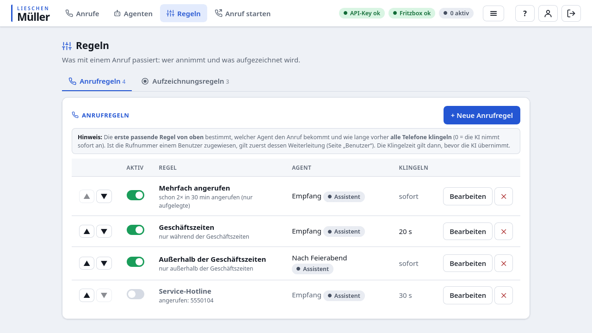

# Agenten und Regeln

**Wofür diese Seite:** Sie erklärt, wie die drei Bausteine zusammenspielen, die bestimmen, *wie* die KI klingt, *wer wann* annimmt und *was* aufgezeichnet wird – und wie man typische Fälle damit einstellt.

| | Frage | Wo |
|---|---|---|
| **Agent** | *Wie* klingt und arbeitet die KI? (Auftrag, Stimme, Modell, Hinweis, Aktionen) | Seite *Agenten* |
| **Anrufregel** | *Wer* nimmt *wann* an, und wie lange klingeln vorher alle Telefone? | Seite *Regeln* → Anrufregeln |
| **Aufzeichnungsregel** | *Was* wird aufgezeichnet? | Seite *Regeln* → Aufzeichnungsregeln |

**Ohne passende Anrufregel nimmt die KI keinen Anruf an.** Einen Agenten und eine Anrufregel braucht man nur, wenn die KI rangehen soll; soll bloß ein Anrufer aufgezeichnet werden, genügt eine Aufzeichnungsregel.

## So wird entschieden (eingehender Anruf)
Reihenfolge in der Bridge:
1. **Fernabfrage-Nummer?** Dann geht der Anruf an die KI ([Fernabfrage und Kalender](Fernabfrage-und-Kalender.md)).
2. **Ist die angerufene Rufnummer einem Benutzer zugewiesen?** Dann gilt dessen Erreichbarkeit: „nicht stören“ → Wählregeln → Zeitplan → Status/„bis“ → Vertretung ([Benutzer und Status](Benutzer-und-Status.md)); die KI übernimmt, wenn niemand abnimmt. Hat die erste passende Anrufregel einen Assistenten mit „Vorher klingeln“ 0, nimmt die KI sofort an: Dann klingelt auch bei zugewiesenen Rufnummern nur, wem eine Wählregel das ausdrücklich erlaubt, und die Vertretung wird nicht angerufen.
3. **Anrufregel:** die erste passende von oben bestimmt den Agenten und die Klingelzeit. Ein Agent im Modus *Durchstellen* verbindet direkt weiter.
4. Vor der Annahme prüft die **Kostenbremse** ([Benachrichtigungen und Kosten](Benachrichtigungen-und-Kosten.md)); ist eine Grenze erreicht, wird der Anruf wie „kein Agent“ behandelt.

## Agenten
Ein Agent ist eine KI-Persönlichkeit (Beispiele: „Anrufbeantworter“, „Notfall“). Der Editor hat Tabs:
- **Allgemein:** Name, Reihenfolge, **Modus** – *Assistent* (spricht mit dem Anrufer), *Monitor* (hört nur mit, Transkript), *Durchstellen* (ohne KI zu einer Nummer).
- **Wechsel:** wann mitten im Gespräch zu diesem Agenten gewechselt wird (siehe unten).
- **Verhalten:** System-Prompt (Auftrag), feste **Hinweis-Ansage** (z. B. „Sie sprechen mit einer KI“), Begrüßung, Fragenliste, Schweige-Watchdog („Sind Sie noch da?“, Auflegen).
- **Stimme und Modell:** Modell mit Preisen, Stimme mit Stimmprobe, Sprechtempo, optional Sprechstil.
- **Vermittlung und Aktionen:** wen der Anrufer genannt verbunden bekommen darf, eigene Aktionen (weiterleiten, Agent wechseln, Wert notieren, Webhook, auflegen).
- **Grenzen und Optionen:** Kostenbremse, „Grundkonfiguration voranstellen“, „Vor dem Verbinden nachfragen“ ([Rückfrage](Rueckfrage-vor-dem-Verbinden.md)), „Anrufer mit Benutzern verbinden“ (nie / nur während der Geschäftszeiten / immer – siehe [Sicherheitsbewertung](Sicherheitsbewertung.md)).

**Platzhalter** in Begrüßung und System-Prompt: `{name}`, `{vorname}`, `{nachname}`, `{anrede}` (aus Kontakten; die Anrede „Herr“/„Frau“ stammt aus dem Kontakt – die App rät sie nie aus dem Namen), sowie `{anzahl}`, `{minuten}`, `{verlauf}`
([Wiederholte Anrufe](Wiederholte-Anrufe.md)). Ist die Nummer unbekannt, fallen Name und „Herr/Frau“ weg. Die Hinweis-Ansage kennt keine Platzhalter.

Gut zu wissen:
- Die **Grundkonfiguration** (Einstellungen → Allgemein) wird jedem Agenten vorangestellt: Hier steht, wer ihr seid. Die KI nennt keine Namen, die nicht im Prompt oder in der Grundkonfiguration stehen.
- Die KI gibt sich auf Nachfrage immer als KI zu erkennen. Mit dem Schalter auf der Agentenkarte schaltet man einen Agenten ein und aus.
- Tempo und Stil sind Wünsche an das Modell, keine exakten Werte.

## Anrufregeln

- Die **erste passende Regel von oben** gewinnt (Reihenfolge mit ▲▼).
- Bedingungen (leer = alle): angerufene Nummer, Anrufer (Kontakte, Benutzer, freie Nummern), Zeitfenster (während/außerhalb der Geschäftszeiten), optional **„mehrfach angerufen“** ([Wiederholte Anrufe](Wiederholte-Anrufe.md)).
- **Klingeln:** Sekunden (0–60), die alle Telefone klingeln, bevor die KI übernimmt. **0 = sofort** (Anrufbeantworter). Das Klingeln läuft über die Klingel-Rufnummer
  ([Klingel-Rufnummern und Anruferanzeige](Klingel-Rufnummern-und-Anruferanzeige.md)); fehlt sie, klingelt die Fritzbox selbst.
- Eine „Catch-all“-Regel (keine Bedingung) gehört **ans Ende** – alles darunter wird nie erreicht.

## Aufzeichnungsregeln
- **Alle passenden Regeln gelten gemeinsam.** Audio, Transkript und KI-Audio werden zusammengeführt.
- Eine Regel **ohne Agent** gilt immer (z. B. für einen bestimmten Anrufer), eine Regel **mit Agent** nur, wenn dieser Agent das Gespräch führt.
- Der Sprachbefehl „keine Aufzeichnung“ ist aus, sobald eine passende Regel ihn abschaltet.
- Eigene Regeln mit „Gilt für: Ausgehende Gespräche“ steuern die Aufzeichnung per Vorwahl ([Ausgehende Gespräche und Mitschrift](Ausgehende-Gespraeche-und-Mitschrift.md)).
- Mehr: [Aufzeichnung](Aufzeichnung.md).

## Wechsel mitten im Gespräch
Ein Agent kann per **Codewort** (erst bei *n* verschiedenen) oder **Stimmung** (aufgeregt, ärgerlich, ängstlich, panisch, unsicher; Tonfall und/oder Wortlaut, Stärke 1–5, verknüpfbar mit UND/ODER) übernehmen, optional nur
bei bestimmten Nummern oder Zeiten. Das stellt man im Agenten ein (Tab *Wechsel*), nicht in einer Regel. Die Stimmungserkennung ist optional (Hinweis zum EU AI Act: [Aufzeichnung](Aufzeichnung.md)).

## Beispiele
- **Anrufbeantworter:** Regel „Immer“ → Agent *Anrufbeantworter*, Klingeln 30 s.
- **Nach Feierabend nur Nachricht aufnehmen:** Anrufregel mit Zeitfenster „außerhalb der Geschäftszeiten“, Klingeln 0.
- **Notfall:** Agent *Notfall* mit Codewort „Notfall“ und Stimmung „aufgeregt, panisch“; keine eigene Anrufregel nötig.
- **Anrufe einer bestimmten Person immer aufzeichnen:** nur eine Aufzeichnungsregel (Anrufernummer, Audio + Transkript, ohne Agent).
- **Wer immer wieder anruft:** ganz oben eine Anrufregel „mehrfach angerufen“ ([Wiederholte Anrufe](Wiederholte-Anrufe.md)).
