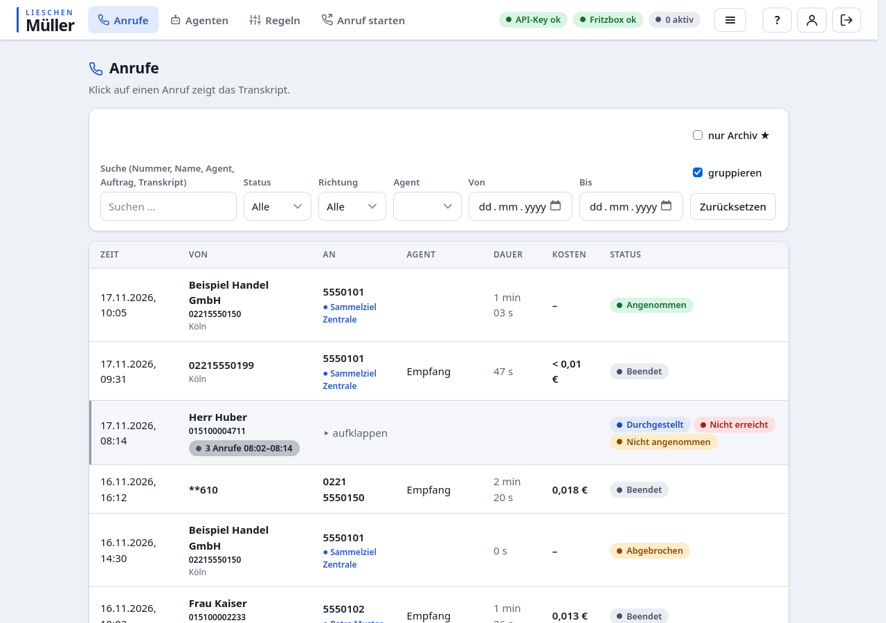
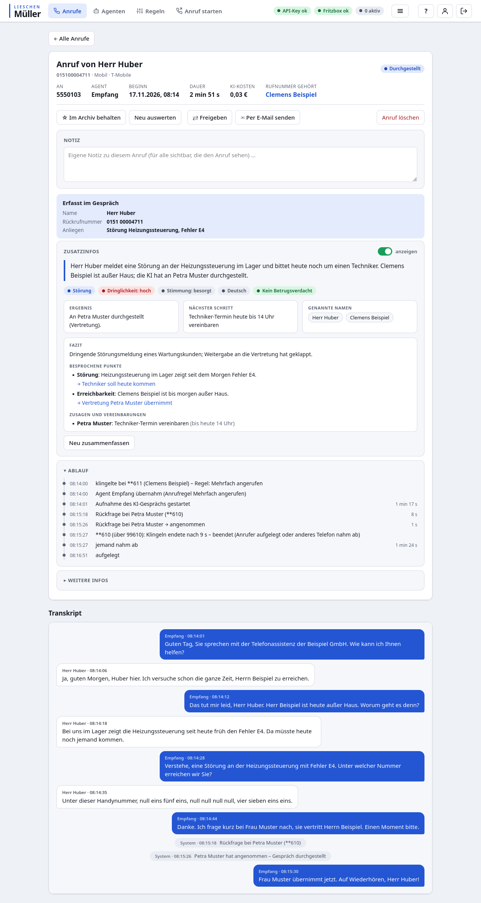

# Anrufliste, Ablauf und Diagnose

**Wofür diese Seite:** Wie man in der Anrufliste nachvollzieht, was mit einem Anruf geschah („Warum hat es nicht geklingelt?“, „Wer hat abgenommen?“, „Warum war ein Telefon still?“), und was die Diagnosewerte bedeuten.

## Anrufliste

Seite *Anrufe*: Suche (auch im Transkript), Filter (Status, Richtung, Agent, Zeitraum), Seitenwechsel. Ein Klick öffnet den Anruf: **Transkript** (Sprecher getrennt, Agentenwechsel mit Grund), Notizen der KI, Kosten, **Aufnahme** (eigene Wiedergabeleiste),
**Zusatzinfos** (Zusammenfassung, Anliegen, Dringlichkeit, Stimmung; optional „Ausführlich zusammenfassen“). **★ Archivieren** hält einen Anruf über die Aufbewahrungsfrist hinaus.

**Status:** *Angenommen* = eine Person nahm ab, bevor die KI dran war. *Durchgestellt* = die KI hat mit einer Person verbunden. *Nicht angenommen* = niemand nahm ab und der Anrufer legte vor der KI auf. *Beendet* = die KI führte das Gespräch.
*Abgelehnt* = z. B. Kostenbremse oder kein Agent. Bei eingehenden Anrufen steht in den Notizen „Angenommen von“ (welches Telefon abnahm, laut Anrufliste der Fritzbox, [Voraussetzungen und Fritzbox](Voraussetzungen-und-Fritzbox.md)).

Bei klingelnden und laufenden Anrufen erscheint oben ein **Banner** (Jetzt von der KI annehmen lassen, Durchstellen, Agent wechseln, Auflegen, Gespräch ansehen); laufende Gespräche steuert man auch in der Anrufansicht.

## Der Abschnitt „Ablauf“

Im geöffneten Anruf zeigt **Ablauf** eine Zeitleiste mit **Uhrzeit** und **Dauer bis zum nächsten Schritt**; er lässt sich zuklappen. Anrufe aus der Zeit vor dieser Funktion haben keinen Ablauf.

### Ablauf-Ereignisse
| Ereignis | Beispieltext |
|---|---|
| Klingeln | „klingelte bei **610 + **620 (Regel: Abends, 25 s)“ |
| Warten bis zur KI | „klingelte, Agent Empfang nimmt nach 20 s ab (Anrufregel Standard)“ |
| niemand nahm ab | „niemand nahm ab (keine Antwort)“ – Zusatz: besetzt, keine Antwort, nicht erreichbar |
| KI übernahm | „Agent Empfang übernahm (Anrufregel Standard)“; „KI nahm den Anrufer wieder an“; „– Fernabfrage möglich“ |
| KI-Ende | „KI-Gespräch beendet: KI hat aufgelegt“ |
| Weiterleitung | „Weiterleitung an **610 mit Mitschrift“; „Rückfrage bei … (**610)“ |
| Rückfrage-Ergebnis | „Rückfrage bei … → angenommen / abgelehnt / Mailbox / keine Antwort“ |
| Durchstellen fehlgeschlagen | „… (besetzt), die KI nimmt wieder an“ |
| jemand nahm ab | „jemand nahm ab“ |
| Aufnahme | „Aufnahme gestartet“, „zweiter KI-Abschnitt angehängt“, „Gespräch angehängt“, „beendet und verworfen“ |
| Kostenbremse / kein Agent | „Kostenbremse: …“, „kein Agent zuständig – nicht angenommen“ |
| manuell | „manuell angenommen (KI)“, „manuell umgeleitet an …“ |
| Anrufer legte auf | „Anrufer legte vor der Annahme auf (oder ein anderes Gerät nahm ab)“; „aufgelegt“ |
| Seitenprüfung, Leitungswerte, Klingel-Ende | siehe unten |

### Klingel-Ende-Gründe
Für jedes angerufene Telefon meldet Asterisk, **warum sein Klingeln endete**, mit der Nummer (bei Anruf über die Klingel-Rufnummer: „**610 (über 99610)“), der Zeit seit dem Klingeln und der SIP-Antwort. Die Gründe (Q.850-Ursache):

| Text | Bedeutung |
|---|---|
| Klingelzeit abgelaufen (nicht abgenommen) | niemand hob ab |
| beendet (Anrufer aufgelegt oder anderes Telefon nahm ab) · ein anderes Telefon nahm ab | normales Ende nach Abnahme anderswo oder Auflegen |
| besetzt | Telefon besetzt |
| Telefon antwortet nicht (nicht erreichbar) · Telefon nicht angemeldet | die Fritzbox erreicht das Telefon nicht (z. B. Akku/Reichweite bei DECT) |
| abgelehnt · nicht abgenommen | das Telefon oder die Fritzbox hat abgelehnt |
| Nummer unbekannt · keine Verbindung zum Ziel · Ziel gestört · keine Leitung frei · Netz gestört · vorübergehende Störung · Fritzbox überlastet · unbekannter Grund | Hinweis auf Konfiguration (Nummer/Klingel-Rufnummer nicht zugewiesen) oder Störung der Fritzbox bzw. Leitung |

## Leitungswerte (Fehlersuche)
Beim Auflegen meldet der Dialplan je Kanal die **RTCP-Werte** von Asterisk: empfangene und gesendete **Pakete**, **Verluste** (bei uns / bei der Gegenseite), **Jitter**. Beispiel: „Leitungswerte angerufenes Telefon: 520 Pakete empfangen, 515 gesendet“.
- Leg **eingehende Leitung** = der Anrufer, Leg **angerufenes Telefon** = die Seite, zu der durchgestellt wurde.
- **0 empfangene Pakete = von dieser Seite kam gar kein Ton an** (der Text sagt es ausdrücklich).
- Viele Verluste oder hoher Jitter deuten auf Netzprobleme (WLAN, Auslastung) hin.

## Seitenprüfung
Bei Gesprächen zwischen Menschen mit getrennten Einzelspuren (Gegenseite und Mitarbeiter) zählt die App vor dem Löschen der Spuren je Seite: Sekunden **Sprache**, **Stille** und einen **425-Hz-Ton** (deutsches Frei-/Besetztzeichen).
Beispiel: „Seitenprüfung: Gegenseite: 0 s Sprache, 2 s Freizeichen/Besetztton (425 Hz, ab 0 s), 8 s Stille ⚠ …“. Warnungen:
- **Freizeichen/Besetztton nach dem Abnehmen:** Das kommt **nie von Asterisk** (dessen Freizeichen und Musik enden mit der Annahme), sondern von der Leitung bzw. dem Telefon dieser Seite.
- **Keine Sprache** auf einer Seite bei mindestens 5 s Länge: Der Ton dieser Seite kam eventuell nicht an.
Es wird nichts gespeichert, was nicht ohnehin aufgenommen wurde; geprüft wird erst ab 1 s Spurlänge.

## Typische Lesarten
- **Telefon klingelt nicht, Ablauf zeigt „Telefon nicht angemeldet“/„nicht erreichbar“:** Telefon in der Fritzbox prüfen; bei Anruf über `99NNN` auch, ob die Nummer dem Telefon zugewiesen und angemeldet ist ([Klingel-Rufnummern und Anruferanzeige](Klingel-Rufnummern-und-Anruferanzeige.md)).
- **Mitarbeiter hört nach dem Abnehmen ein Freizeichen:** Seitenprüfung ansehen (Ton auf welcher Seite?) und Leitungswerte.
- **Anruf „Nicht angenommen“, obwohl jemand abnahm:** „Anrufer legte vor der Annahme auf (oder ein anderes Gerät nahm ab)“ – die Anrufliste der Fritzbox zeigt, wer abnahm.
