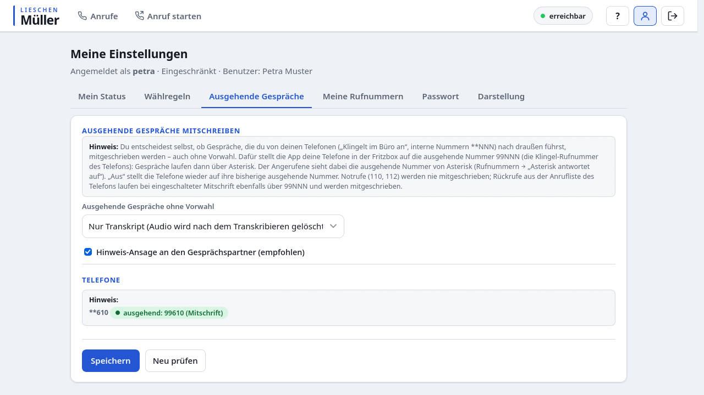

# Ausgehende Gespräche und Mitschrift

**Wofür diese Seite:** Eigene Telefonate (von den Telefonen an der Fritzbox nach draußen) lassen sich aufnehmen und als Text mitschreiben. Es gibt drei Wege; die Seite erklärt sie, den Schutz bei Ausfällen
(Wächter/Notbetrieb), die Grenzen und die rechtliche Seite. KI-Anrufe (Assistent ruft an, Kampagnen) sind etwas anderes: Sie werden immer transkribiert, das Audio wird nicht aufgenommen.

## Die drei Wege
| Weg | So geht es | Wer entscheidet |
|---|---|---|
| **A. Vorwahl** (Wahlregel in der Fritzbox) | Man wählt die **Vorwahl** (Standard `*77`, einstellbar, z. B. `000`) vor die Nummer: `*77` + `030 12345678`. Die Fritzbox-Wahlregel leitet über eine Klingel-Rufnummer `99NNN` zu Asterisk. | wer die Vorwahl wählt; Regeln: Aufzeichnungsregeln „Ausgehende Gespräche“ |
| **B. Mitschrift je Benutzer ohne Vorwahl** | Die App stellt das Telefon in der Fritzbox auf die **ausgehende Nummer `99NNN`**. Dann laufen alle Gespräche des Telefons über Asterisk und werden nach der Einstellung des Benutzers mitgeschrieben. | der Benutzer (*Meine Einstellungen → Ausgehende Gespräche*), Administratoren im Benutzer-Editor |
| **C. „Ich telefoniere – mit Mitschrift“** | Seite *Anruf starten*: Zuerst klingelt der eigene Anschluss, danach wird das Ziel gewählt. Beide Seiten werden aufgenommen. | wer die Seite benutzt |

### Weg A: Vorwahl
- Einstellung: *Einstellungen → Telefonie → Aufzeichnung von Gesprächen → „Vorwahl für aufgezeichnete ausgehende Gespräche“* (1 bis 8 Zeichen aus Ziffern, `*`, `#`; **Standard `*77`**, z. B. auch `000`).
- Einmalig in der Fritzbox (je nach FRITZ!OS-Version z. B. Telefonie → Eigene Rufnummern → Wahlregeln): „Rufnummer beginnt mit“ **derselben Vorwahl** (z. B. `*77`) → über eine bei Asterisk angemeldete Klingel-Rufnummer `99…` wählen
  ([Klingel-Rufnummern und Anruferanzeige](Klingel-Rufnummern-und-Anruferanzeige.md)). Diese Nummer muss bei Asterisk **eingeschaltet** bleiben.
- Die Bridge entfernt die Vorwahl, prüft das Ziel (siehe Wählschutz) und wählt über Asterisk. **Aufgezeichnet wird nur, wenn eine aktive Aufzeichnungsregel „Ausgehende Gespräche“ passt**
  (Bedingungen: Zielnummer/Kontakt, Zeitfenster; Optionen: Audio, Transkript, Hinweis-Ansage, Sprachbefehl, Mail-Empfänger). Passt keine, wird normal ohne Aufzeichnung gewählt.
  Eine neue Installation hat schon die aktive Regel **„Ausgehende Gespräche (Vorwahl)“** (alle Ziele: Transkript, Hinweis-Ansage, Sprachbefehl; Audio nur bei „Audio dauerhaft speichern“).
- „Auch ausgehende Gespräche **ohne** Vorwahl mitschreiben, die über Asterisk laufen“ (Einstellung, Standard aus): betrifft Rückrufe aus der Anrufliste eines Telefons über eine `99…` und Telefone, deren ausgehende Nummer in der Fritzbox eine Klingel-Rufnummer ist.

### Weg B: Mitschrift je Benutzer (ohne Vorwahl)

Auswahl: **Aus** (wie bisher: nur mit Vorwahl) · **Aufnahme und Transkript** · **Nur Transkript** (das Audio wird nach dem Transkribieren gelöscht) · **Nur an bestimmte Nummern** (Liste wie bei „nicht stören“, mit `*` am Ende eine Nummerngruppe) .
- **Hinweis-Ansage** an den Gesprächspartner: standardmäßig **an**; Abschalten nur mit Warnhinweis.
- **Was die App tut:** Beim Einschalten stellt sie jedes Telefon unter „Klingelt im Büro an“ (nur dreistellige interne Nummern `**NNN`) in der Fritzbox auf die **ausgehende Nummer `99NNN`** – nur wenn die `99NNN` eingerichtet, in der Fritzbox angelegt
  und bei Asterisk angemeldet ist, und nur für **DECT- und IP-Telefone**. Die bisherige ausgehende Nummer merkt sie sich; „Aus“ stellt sie wieder her. Scheitert ein Telefon, stellt sie die schon umgestellten zurück und speichert nichts.
  Das geschieht über die Weboberfläche der Fritzbox ([Voraussetzungen und Fritzbox](Voraussetzungen-und-Fritzbox.md)).
- Der Angerufene sieht dabei die **ausgehende Nummer von Asterisk** (Seite *Rufnummern → „Asterisk antwortet auf“ → Ausgehende Nummer*, eine echte Rufnummer der Fritzbox).
- Die Mitschrift erscheint in der Anrufliste mit dem Namen des Benutzers („Name (**NNN, ausgehend)“); der Benutzer sieht seine Mitschriften selbst.
- **Notrufe (110, 112) werden nie mitgeschrieben**, auch nicht mit Vorwahl.
- **Rückrufe aus der Anrufliste** des Telefons laufen bei eingeschalteter Mitschrift ebenfalls über `99NNN` und werden mitgeschrieben.
- Ein gemeinsames Telefon kann nur **ein** Benutzer umstellen (für andere steht „anderer Benutzer“).

## Wächter und Notbetrieb
Läuft ein Telefon ausgehend über `99NNN`, hängt das Telefonieren nach draußen an Asterisk. Darum bewacht die App das:
- Alle **30 Sekunden** prüft sie, ob die `99NNN` der umgestellten Telefone bei Asterisk angemeldet ist.
- Fehlt sie **länger als 90 Sekunden** (oder ist Asterisk nicht erreichbar), stellt die App das Telefon auf seine bisherige Nummer zurück (**Notbetrieb**: Telefonieren geht, aber ohne Mitschrift), schickt eine **Mail an alle aktiven Mail-Empfänger**
  und schreibt es ins Protokoll. Ist die Nummer wieder da, stellt sie das Telefon wieder um. Beim Start gleicht sie den Stand mit der Fritzbox ab. Die Tabelle „Anruferanzeige“ zeigt „ausgehend: 99NNN (Mitschrift)“ bzw. „Notbetrieb“.
- Fällt nur die **Bridge** aus, wählt der Dialplan ohne Mitschrift normal weiter. Bei Weg A entfernt der Dialplan dabei selbst die eingestellte Vorwahl (Standard `*77`; Asterisk-Global `REC_PREFIX` in `data/asterisk/globals.conf`, das die Bridge beim Start und beim Speichern der Vorwahl schreibt).
- Zusätzlich gibt es den externen Wächter `ops/watchdog.py` ([Betrieb und Überwachung](Betrieb-und-Ueberwachung.md)).

## Grenzen
- **Fällt der ganze Rechner aus** (Bridge **und** Asterisk), kann niemand zurückstellen: Die umgestellten Telefone erreichen nach draußen dann niemanden, bis jemand in der Fritzbox (Telefonie → Telefoniegeräte → Bearbeiten → ausgehende Rufnummer)
  die bisherige Nummer einstellt. Das gilt auch für den Weg „ohne Vorwahl immer über Asterisk“; mit Vorwahl (Weg A) ist man nur betroffen, wenn man die Vorwahl wählt.
- Die Umstellung braucht die inoffizielle Weboberfläche der Fritzbox; nach einem FRITZ!OS-Update kann sie ausfallen (dann Weg A oder von Hand umstellen).
- Nur DECT- und IP-Telefone, nur `**NNN` mit drei Ziffern; analoge Anschlüsse nicht.
- **Wählschutz:** Nach dem Entfernen der Vorwahl gilt `DIAL_BLOCK` (`.env`; Standard sperrt `0900`, `0137`, `0180`, `0190`, `118` und `00`, also **auch Auslandsnummern**). Gesperrte Ziele werden nicht gewählt. Nur Ziffern (3 bis 20) oder interne `**N`.
- Die Vorwahl und die Fritzbox-Wahlregel müssen zusammenpassen: Steht in den Einstellungen `*77`, in der Fritzbox aber `000`, wird die Nummer nicht über Asterisk geführt.
- **Wahlregeln der Fritzbox haben Vorrang** vor der ausgehenden Nummer des Telefons (Weg B): Leitet eine Wahlregel bestimmte Nummern über eine andere Verbindung (z. B. Handynummern über einen Preselect- oder Call-by-Call-Anbieter), laufen diese Gespräche an Asterisk vorbei und werden **nicht** mitgeschrieben. Solche Wahlregeln prüfen bzw. auf die gewünschten Nummern beschränken.

## Hinweis-Ansage und Recht
- Die feste Ansage lautet: „Hinweis: Dieses Gespräch wird aufgezeichnet und transkribiert.“ Sie wird dem **Angerufenen** vorgespielt, vor der Aufnahme (je Regel abschaltbar). Der Anrufer (der eigene Mitarbeiter) bekommt keinen Hinweis.
- **Recht:** Gespräche ohne Wissen des Gesprächspartners aufzunehmen oder mitzuschreiben ist strafbar (§ 201 StGB). Ohne Hinweis-Ansage ist die Aufzeichnung nur zulässig, wenn alle Beteiligten anderweitig informiert sind und zugestimmt haben. Das liegt in der
  Verantwortung des Betreibers (siehe auch [Datenschutz und Sicherheit](Datenschutz-und-Sicherheit.md)).
- Mails zu Gesprächen mit Mitschrift bekommen Empfänger mit „Auch bei Gesprächen mit Mitschrift benachrichtigen“ ([Benachrichtigungen und Kosten](Benachrichtigungen-und-Kosten.md)).
