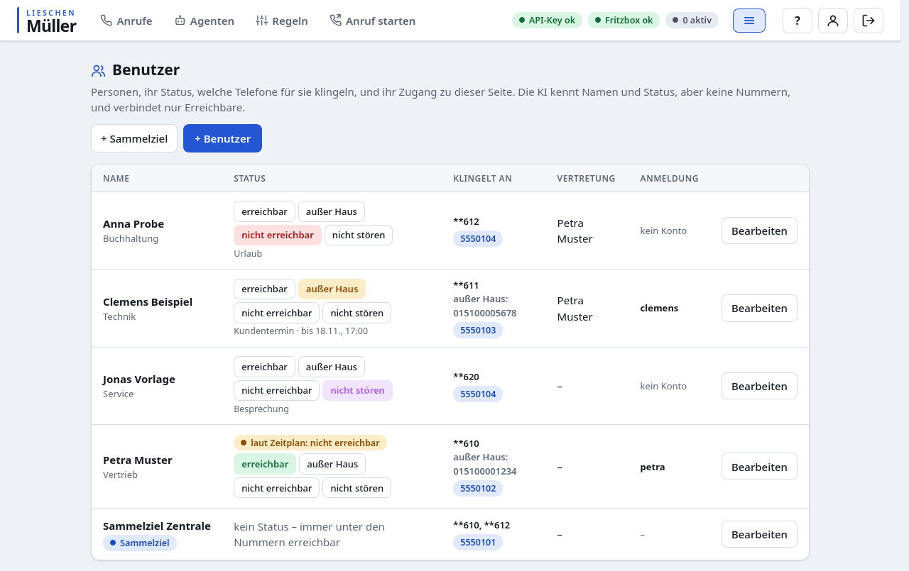
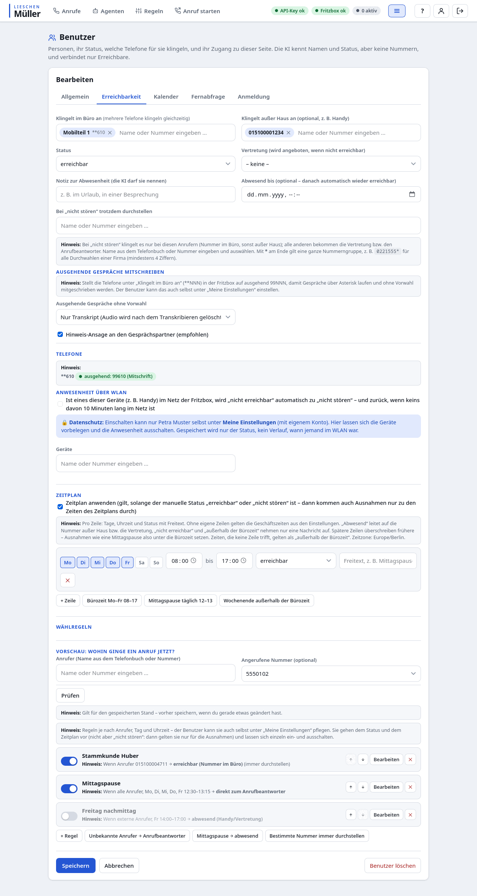

# Benutzer und Status

**Wofür diese Seite:** Wie man Personen (und Sammelziele) anlegt und festlegt, wann und wohin ihre Anrufe gehen: Status, Ausnahmen bei „nicht stören“, Vertretung, Zeitplan, Wählregeln und die
Rangfolge, nach der entschieden wird. Die KI verbindet nur mit Personen, die für den Anrufer **gerade erreichbar** sind.

Seite *Benutzer* (Menü ☰). Ein **Benutzer** ist eine Person (oder ein Sammelziel); ein **Konto** ist ihr Zugang zur Oberfläche (optional, siehe unten).

## Tabs beim Bearbeiten

| Tab | Inhalt |
|---|---|
| **Allgemein** | Name, Funktion, zugewiesene Rufnummern, „Nimmt niemand ab, übernimmt die KI“, Mitschrift-Optionen, Anreden für die Rückfrage |
| **Erreichbarkeit** | Nummer im Büro, **Nummer außer Haus** (z. B. Handy), Status, Vertretung, Notiz, „abwesend bis“, **Zeitplan**, **Wählregeln**, Ausnahmen bei „nicht stören“, Vorschau |
| **Kalender**, **Fernabfrage** | [Fernabfrage und Kalender](Fernabfrage-und-Kalender.md) |
| **Anmeldung** | Konto, Rolle, Passwort |

Der Benutzer ändert vieles selbst unter **Meine Einstellungen** (Status, Notiz, „abwesend bis“, Nummern, Ausnahmen, Wählregeln, Anwesenheit, ausgehende Mitschrift) und über den Statusknopf
in der Kopfzeile (nur, wenn das Konto mit einem Benutzer verknüpft ist).

## Die vier Status
Ein farbiger Punkt in der Kopfzeile zeigt den Status; ein Klick öffnet die Auswahl, die Umschaltung gilt sofort.

| Status | Farbe | Wirkung für Anrufer |
|---|---|---|
| **erreichbar** (im Büro) | grün | Anrufe gehen an die **Nummer im Büro** |
| **außer Haus** | gelb | Anrufe gehen an die **Nummer außer Haus** (z. B. Handy); ohne diese Nummer gilt die Vertretung |
| **nicht erreichbar** | rot | niemand; es gilt die Vertretung, sonst übernimmt die KI |
| **nicht stören** | lila | wie „nicht erreichbar“, **aber Ausnahmen kommen durch** |

- **Mehrere Nummern:** In „Klingelt im Büro an“ und „Klingelt außer Haus an“ lassen sich bis zu 5 Nummern eintragen (z. B. `**610, **620`). Sie klingeln gleichzeitig; wer zuerst abnimmt, bekommt das Gespräch.
  Eingeschränkte Konten tragen selbst nur interne Nummern (`**NNN`) für „im Büro“ ein.
- **Notiz** („im Urlaub bis Montag“): Die KI darf sie dem Anrufer nennen. Bei „nicht stören“ erfahren Anrufer aus den Ausnahmen den Grund nicht.
- **„abwesend bis“:** Danach setzt sich der Status von selbst auf „erreichbar“. Das ist in der Oberfläche als automatisch gesetzt markiert (⚙).

### Nicht stören und Ausnahmen mit `*`
Anrufer aus der Liste **„Bei ‚nicht stören‘ trotzdem durchstellen“** werden weiter verbunden – an die Nummer im Büro, sonst die außer Haus. Alle anderen werden behandelt wie bei „nicht erreichbar“.
- Einträge: Rufnummern in jeder Schreibweise (auch `+49 …`), höchstens 30, mindestens 3 Ziffern.
- **Mit `*` am Ende** gilt ein Eintrag für eine ganze Nummerngruppe, z. B. `030123*` für alle Durchwahlen einer Firma (mindestens **4 Ziffern** vor dem `*`, damit nicht versehentlich ein ganzes Ortsnetz durchkommt).
- Das gilt beim Klingeln **und** wenn die KI verbindet. Die KI sagt anderen Anrufern nur, dass die Person gerade nicht erreichbar ist.
- „Nicht stören“ steht über den Wählregeln und – wenn ein Zeitplan angewendet wird – unter dessen Zeiten (siehe Rangfolge).

## Vertretung
Ist die Person nicht erreichbar, klingelt stattdessen die **Vertretung** – nach denselben Regeln und für denselben Anrufer, ohne Vertretung der Vertretung. Ausnahme: Die Wählregel
„direkt zum Anrufbeantworter“ geht ohne Vertretung zur KI. Ist niemand erreichbar, übernimmt die KI.

## Zeitplan
Der **Zeitplan** besteht aus Zeilen mit Tagen, Uhrzeit von–bis, Status (*erreichbar*, *abwesend*, *nicht erreichbar*, *außerhalb der Bürozeit*) und Freitext. **Spätere Zeilen überschreiben frühere**; Zeiten, die keine Zeile trifft,
gelten als „außerhalb der Bürozeit“. Beispiel: „Mo–Fr 08:00–17:00 erreichbar“ und darunter „täglich 12:00–13:00 abwesend (Mittagspause)“.
- Es gibt den **globalen Zeitplan** (Einstellungen → Allgemein → Geschäftszeiten) und einen **eigenen je Benutzer**; mit „Zeitplan anwenden“ gilt der eigene Zeitplan (hat er keine eigenen Zeilen, der globale); ohne den Schalter gilt für den Benutzer keiner.
- Der Zeitplan gilt bei „erreichbar“ **und** bei „nicht stören“. „abwesend“ → Nummer außer Haus; „nicht erreichbar“ oder „außerhalb der Bürozeit“ → niemand, auch keine Ausnahme von „nicht stören“.
- Die globalen Geschäftszeiten nutzen auch Anrufregeln und Aufzeichnungsregeln („nur während/außerhalb der Geschäftszeiten“).

## Wählregeln
Je Benutzer lassen sich bis zu **30 Wählregeln** anlegen (Seite *Meine Einstellungen → Wählregeln* oder Benutzer-Editor): „wenn Anrufer … zu der Zeit … auf die Nummer …, dann …“. Jede Regel hat einen Ein/Aus-Schalter; die **erste passende** gilt.
- **Anrufer:** alle, bestimmte Nummern (auch mit `*` am Ende), aus dem Telefonbuch, unbekannte externe, interne oder externe Anrufer.
- **Wann/Worauf:** Wochentage, Uhrzeit von–bis („bis 23:59“ gilt bis Tagesende), angerufene Nummer.
- **Aktion:** *erreichbar* (Nummer im Büro), *abwesend* (Nummer außer Haus/Vertretung), *nicht erreichbar* (Vertretung/Anrufbeantworter), *weiterleiten an* eine bestimmte Nummer, *direkt zum Anrufbeantworter* (KI).
- Beispiele: „bestimmte Kunden immer durchstellen“, „unbekannte Anrufer zum Anrufbeantworter“.

## Rangfolge
Ob ein Anrufer jemanden erreicht, wird **an einer Stelle** entschieden – beim Klingeln, wenn die KI verbindet, in der Mitarbeiterliste der KI und in der Vorschau:

1. **„nicht stören“:** Nur Ausnahmen kommen weiter. Auch eine Wählregel „erreichbar“ hilft den anderen nicht.
2. **Wählregeln:** erste passende eingeschaltete Regel.
3. **Zeitplan** (wenn angewendet).
4. **Manueller Status** (bzw. „abwesend bis“).
5. **Vertretung**, danach die **KI**.

Ausnahme: Hat die erste passende Anrufregel einen Assistenten mit „Vorher klingeln“ 0, nimmt die KI sofort an: Dann klingelt auch bei zugewiesenen Rufnummern nur, wem eine Wählregel das ausdrücklich erlaubt, und die Vertretung wird nicht angerufen.

Soll nachts ein bestimmter Anrufer trotz Zeitplan durchkommen, legt man für ihn eine Wählregel „erreichbar“ an (Wählregeln stehen über dem Zeitplan).

**Vorschau:** Unter *Benutzer → Erreichbarkeit* (und in *Meine Einstellungen → Wählregeln*) gibt man eine Anrufernummer oder einen Namen aus dem Telefonbuch ein und sieht „Ein Anruf von … ginge jetzt an …, weil …“ – mit
genau dieser Rangfolge und dem gespeicherten Stand. Vor dem Speichern von Regeln ausprobieren spart Testanrufe.

## Sammelziel (z. B. Zentrale)
Mit **„+ Sammelziel“** legt man ein Ziel ohne Person an: nur Name und Nummern (klingeln gleichzeitig), optional Zeitplan, Wählregeln und Vertretung. Ein Sammelziel hat **keinen Status** (es ist immer unter seinen
Nummern erreichbar, außer der Zeitplan sagt etwas anderes), keine WLAN-Anwesenheit und kein Konto. Es kann Vertretung sein und von der KI oder bei der Rückfrage als Ziel gewählt werden.

## Rufnummern zuweisen
Seite *Rufnummern*: Die Fritzbox-Nummern werden **einem** Benutzer (exklusiv) oder **mehreren** (geteilt: alle Erreichbaren klingeln gleichzeitig) zugewiesen. Wer eine Nummer hat, **sieht die Anrufe darauf**
(ab der Zuweisung; ältere Anrufe bleiben für Administratoren sichtbar oder lassen sich einzeln freigeben). Nur Administratoren weisen zu. Dieselbe Seite zeigt auch, auf welchen Nummern das IP-Telefon von Asterisk antwortet
(„Übernehmen“ ändert das in der Fritzbox), und die Klingel-Rufnummern ([Klingel-Rufnummern und Anruferanzeige](Klingel-Rufnummern-und-Anruferanzeige.md)).

## Konten und Rollen
- **Eingeschränkt:** sieht eigene und freigegebene Anrufe, ändert den eigenen Status und die eigenen Wählregeln. Hat der Benutzer einen eigenen Anschluss, kann er unter *Anruf starten* Gespräche mit Mitschrift führen.
- **Administrator:** sieht und ändert alles.
- Passwörter: mindestens 10 Zeichen. Ohne „Angemeldet bleiben“ endet die Anmeldung nach 12 Stunden ohne Aktivität (längstens 7 Tage); mit dem Häkchen nach 30 Tagen ohne Aktivität, spätestens nach 90 Tagen. Ein neues Passwort beendet
  die Anmeldung auf allen anderen Geräten.

Weiter: [WLAN-Anwesenheit](WLAN-Anwesenheit.md) (Status automatisch setzen) · [Rückfrage vor dem Verbinden](Rueckfrage-vor-dem-Verbinden.md) · [Agenten und Regeln](Agenten-und-Regeln.md)
