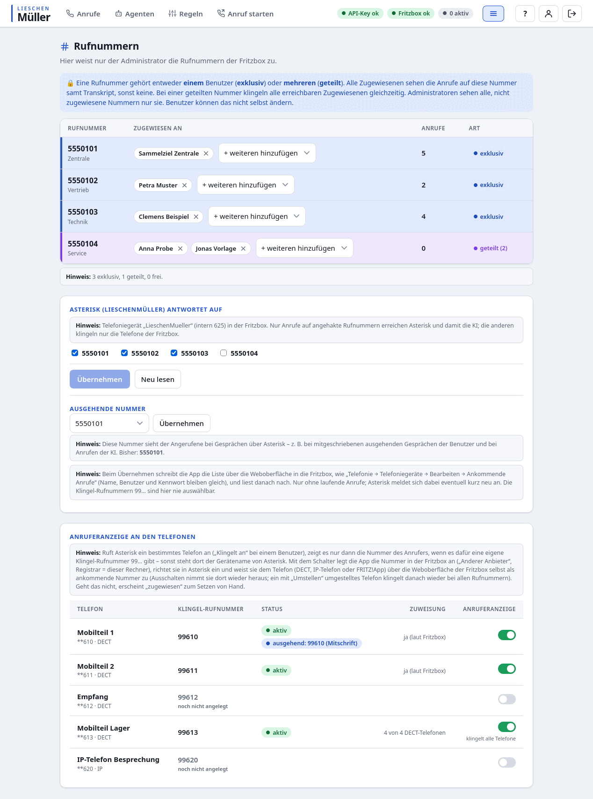

# Klingel-Rufnummern und Anruferanzeige

**Wofür diese Seite:** Wie alle Telefone klingeln und dabei die **echte Nummer des Anrufers** zeigen. Das geht über Klingel-Rufnummern `99NNN`, die die Fritzbox als „Anderer Anbieter“ bei Asterisk anmeldet.
(Technischer Hintergrund und Sicherheit: [Fritzbox-Anbindung](Fritzbox-Anbindung.md).)

## Was eine Klingel-Rufnummer ist
Eine Klingel-Rufnummer ist **keine echte Rufnummer**, sondern `99` + die interne Nummer eines Telefons (`99610` für `**610`). Die Fritzbox legt sie als Rufnummer „Anderer Anbieter“ an (Registrar = **der Rechner mit Asterisk**) und meldet sie bei Asterisk an.
Ruft Asterisk darüber an, ist das für die Fritzbox ein externer Anruf: Das Telefon zeigt die **Nummer des Anrufers** statt des Gerätenamens „LieschenMueller“. Ohne Klingel-Rufnummer klingelt die Fritzbox selbst, und die KI übernimmt als normales IP-Telefon.

## Grundleitung „alle Telefone klingeln“
*Einstellungen → Telefonie → Klingeln der Telefone*: Hier steht die Nummer, über die Asterisk **alle Telefone** klingeln lässt (mehrere mit `+`, leer = aus; Voreinstellung `99613`).
- Nimm eine Klingel-Rufnummer, die in der Fritzbox **allen Telefonen zugewiesen** ist, die klingeln sollen (z. B. die des Empfangs, `99611`).
- Asterisk richtet diese Nummer **immer von selbst** ein; in der Tabelle ist sie mit „klingelt alle Telefone“ markiert und lässt sich dort nicht ausschalten. Zum Wechseln zuerst hier die neue Nummer eintragen, dann kann die alte in der Tabelle aus.
- Ablauf: Asterisk nimmt den Anruf an, lässt über die Grundleitung alle Telefone klingeln (so lange, wie die Anrufregel unter *Klingeln* sagt) und übernimmt dann mit der KI. Hebt jemand ab, wird durchgestellt (und je Aufzeichnungsregel aufgezeichnet).
- Optionen dort: Wartemusik statt Freizeichen, Verzögerung vor dem Klingeln, Schreibweise der Anrufernummer (`+49…`/`0049…`), falls die Fritzbox den Ton nicht durchschaltet ([Einstellungen](Einstellungen.md)).

## Anruferanzeige je Telefon (Seite *Rufnummern*)

Damit ein Telefon beim **gezielten** Anruf („Klingelt an“ bei einem Benutzer) die Nummer des Anrufers zeigt, braucht es eine eigene Klingel-Rufnummer `99NNN` (`99610` für `**610`).
Auf der Seite **Rufnummern → „Anruferanzeige an den Telefonen“** gibt es dafür eine Tabelle mit Schalter je Telefon:
- **Einschalten** legt die Nummer in der Fritzbox an (TR-064, falls sie fehlt; wird nichts überschrieben, wenn sie schon existiert), trägt sie bei Asterisk ein und **weist sie dem Telefon als ankommende Nummer zu** –
  DECT-Telefonen, IP-Telefonen und FRITZ!Apps über die Weboberfläche der Fritzbox. Danach liest die App nach und stellt bei Abweichung den alten Stand wieder her.
- **Ausschalten** nimmt die Nummer beim Telefon heraus und trägt sie bei Asterisk aus (in der Fritzbox bleibt sie stehen). Eine Nummer, die für „alle Telefone klingeln“ genutzt wird, lässt sich nicht ausschalten.
- Geht Lesen oder Schreiben nicht (z. B. nach einem FRITZ!OS-Update, [Voraussetzungen und Fritzbox](Voraussetzungen-und-Fritzbox.md)), erscheint das Häkchen „zugewiesen“ zum Setzen von Hand.
- **Analoge Anschlüsse** bleiben unverändert (nur DECT-/IP-Telefone lassen sich umstellen).
- **Automatische Zuweisung** passiert nur, wenn das Telefon eine feste Rufnummernauswahl hat (siehe nächster Abschnitt).

### Telefone auf „alle Rufnummern“
Ein Telefon, das in der Fritzbox bei **allen Rufnummern** klingelt, klingelt auch bei jeder fremden `99…`. Die App stellt es deshalb **nicht von selbst** um. Asterisk ruft es direkt an (ohne Anrufernummer), bis man **„Umstellen?“** wählt:
Das Telefon bekommt dann nach Rückfrage eine feste Auswahl (echte Rufnummern bzw. die seiner Benutzer, die Nummer für „alle Telefone klingeln“ und seine eigene `99NNN`). **„auf ‚alle‘ zurück“** macht das rückgängig.

## Von Hand in der Fritzbox
Telefonie → Eigene Rufnummern → Neue Rufnummer → **Anderer Anbieter**: Rufnummer und Benutzername = `99NNN`, beliebiges Kennwort (Asterisk prüft es nicht), **Registrar = IP des Rechners** (nicht der Fritzbox). Anschließend dem Telefon bzw. allen klingelnden
Telefonen zuweisen. Die Nummer ist über die IP-Adresse abgesichert ([Fritzbox-Anbindung](Fritzbox-Anbindung.md)).

## Vorwahl-Weg (Wahlregel)
Die Fritzbox-Wahlregel für aufgezeichnete ausgehende Gespräche (z. B. „beginnt mit `*77`“, der Standard-Vorwahl) wählt **über eine Klingel-Rufnummer**. Jede bei Asterisk eingeschaltete `99…` funktioniert; am einfachsten dieselbe wie für „alle Telefone klingeln“.
Schaltet man die Nummer der Wahlregel aus, nimmt Asterisk ihre Anmeldung nicht mehr an und die Wahlregel geht nicht mehr (die App fragt vorher nach). Siehe [Ausgehende Gespräche und Mitschrift](Ausgehende-Gespraeche-und-Mitschrift.md).

## Nach dem Update (bis 2026-11 stand `99613` fest)
Früher war `99613` fest in Asterisk eingebaut. Beim ersten Start nach dem Update trägt die App sie einmal als eingeschaltete Klingel-Rufnummer ein – es ändert sich nichts. Soll sie wegfallen: zuerst die Grundleitung (*Einstellungen → Klingeln der Telefone*) und die Wahlregel
in der Fritzbox auf eine andere Nummer umstellen, dann die alte in der Tabelle ausschalten.

## Prüfen
- Angemeldet? `docker compose exec asterisk asterisk -rx 'pjsip show contacts'` – die Klingel-Rufnummer muss dort stehen (die Spalte *Status* unter *Rufnummern → Anruferanzeige an den Telefonen* zeigt es ebenfalls). Der Wächter ([Betrieb und Überwachung](Betrieb-und-Ueberwachung.md)) prüft jede eingetragene Klingel-Rufnummer (aus `data/asterisk/fritz.conf`) und meldet sich nach 7 Minuten ohne Anmeldung.
- Nach einem Neustart von Asterisk meldet sie sich erst nach bis zu 5 Minuten wieder an.
- Im Ablauf eines Anrufs zeigt „Klingeln endete …“, über welche Nummer ein Telefon angerufen wurde ([Anrufliste, Ablauf und Diagnose](Anrufliste-Ablauf-und-Diagnose.md)).
